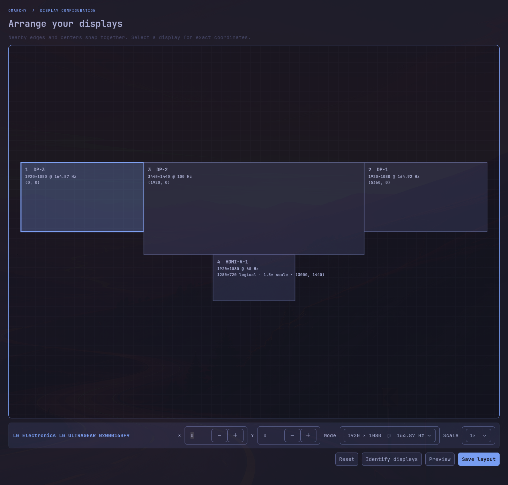

# Monitor Layout for Omarchy



A visual, Windows-style display arrangement editor built specifically for
[Omarchy](https://omarchy.org/) and Hyprland. Drag monitors into place, snap
them along shared edges, identify physical displays, and configure resolution,
refresh rate, and scale without hand-editing `monitors.lua`.

## Features

- Windows-style magnetic edge docking with start, center, and end anchors
- Automatic best-mode selection from each display's advertised modes
- Per-display resolution, refresh-rate, scale, and exact X/Y controls
- Fullscreen numbered display identification
- Live preview before saving
- Native Omarchy theme colors loaded from the active `colors.toml`
- Timestamped configuration backups and automatic rollback on validation errors
- Optional desktop application launcher and icon

## Requirements

- Omarchy 4 with Hyprland and the Quickshell plugin system
- Python 3.11 or newer
- GTK 4 and PyGObject (`python-gobject` on Arch Linux)
- `hyprctl`

Omarchy currently includes these runtime dependencies by default. The plugin
does not download dependencies, use `sudo`, access the network, or collect data.

## Install

Install from the public repository:

```bash
omarchy plugin add https://github.com/CJgarcia1229/omarchy-monitor-layout.git --enable
```

Open the editor through the Omarchy shell:

```bash
omarchy-shell shell summon io.github.cjgarcia1229.monitor-layout '{}'
```

To also register **Monitor Layout** in the desktop application launcher:

```bash
~/.config/omarchy/plugins/io.github.cjgarcia1229.monitor-layout/install-app.sh
```

## Usage

1. Drag display cards until they match the physical arrangement.
2. Select a display to change its exact position, mode, refresh rate, or scale.
3. Use **Identify displays** to show a number on every physical screen.
4. Click **Preview** to apply the arrangement temporarily.
5. Click **Save layout** to persist it to `~/.config/hypr/monitors.lua`.

The canvas uses Hyprland's logical dimensions for correct pointer transitions.
Each card separately shows its physical signal mode and scaled logical size.

## Safety and configuration access

The application reads monitor state using `hyprctl monitors all -j`. Preview
uses `hyprctl keyword monitor`. Saving writes only
`~/.config/hypr/monitors.lua`, after first making a timestamped backup. It then
runs `hyprctl reload` and `hyprctl configerrors`; if validation reports an
error, the previous file is restored automatically.

## Remove

Remove the Omarchy plugin:

```bash
omarchy plugin remove io.github.cjgarcia1229.monitor-layout
```

If you installed the optional desktop launcher, remove its two user files:

```bash
rm -f ~/.local/share/applications/io.github.cjgarcia1229.monitor-layout.desktop
rm -f ~/.local/share/icons/hicolor/scalable/apps/omarchy-monitor-layout.svg
```

Monitor configuration and timestamped backups are intentionally left in place.

## Development

Validate the plugin before committing:

```bash
omarchy plugin validate .
python3 -m py_compile monitor_layout.py
```

## License

[MIT](LICENSE)
